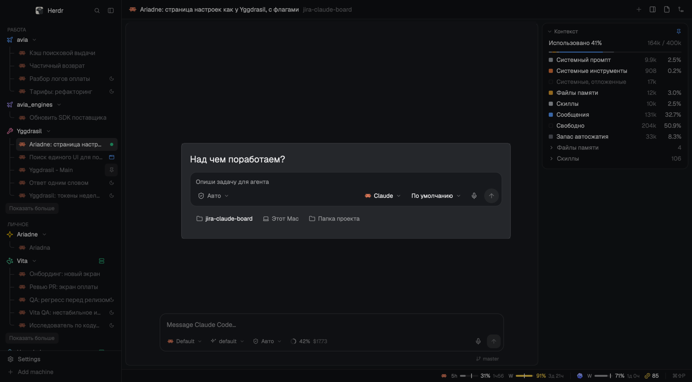
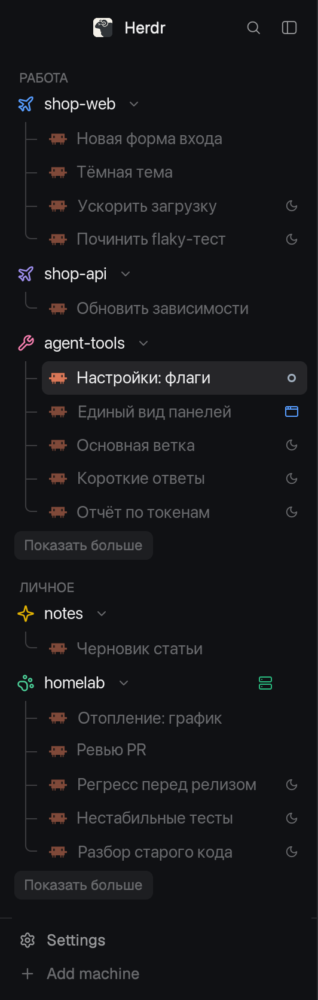
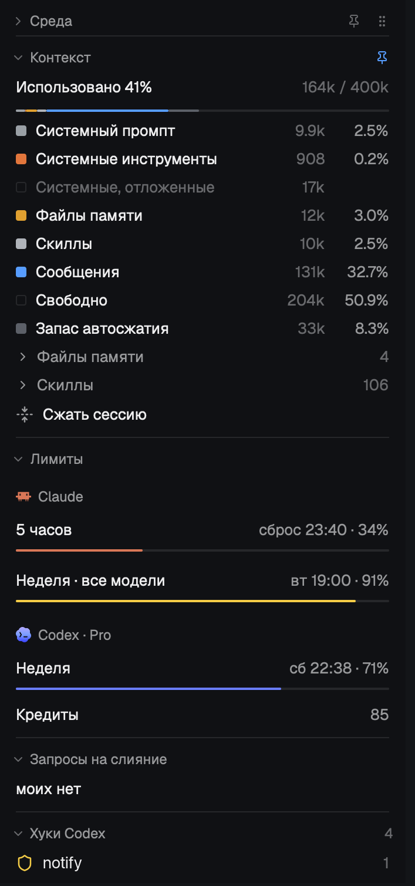
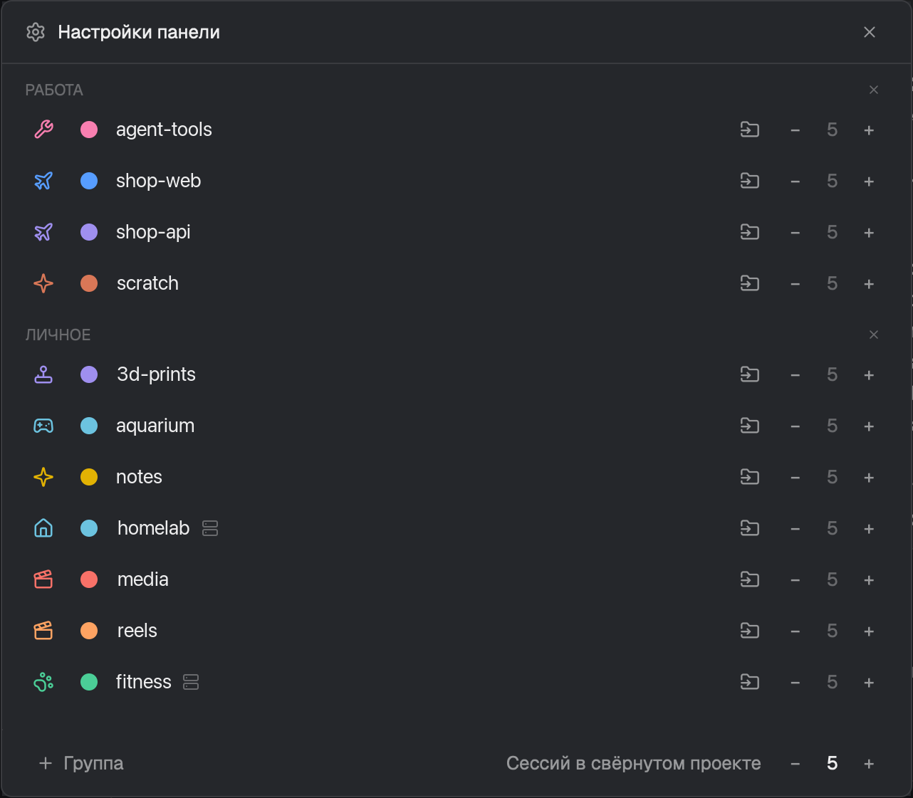
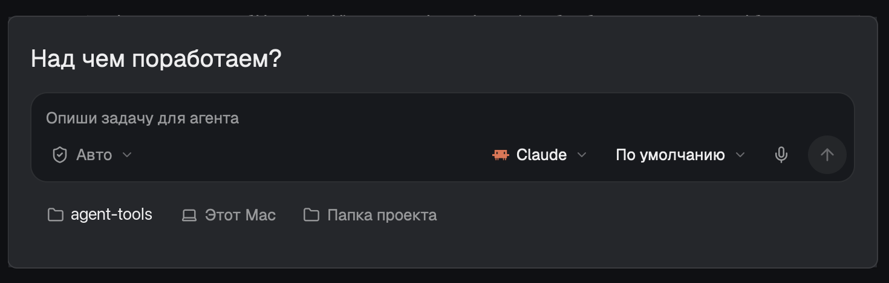
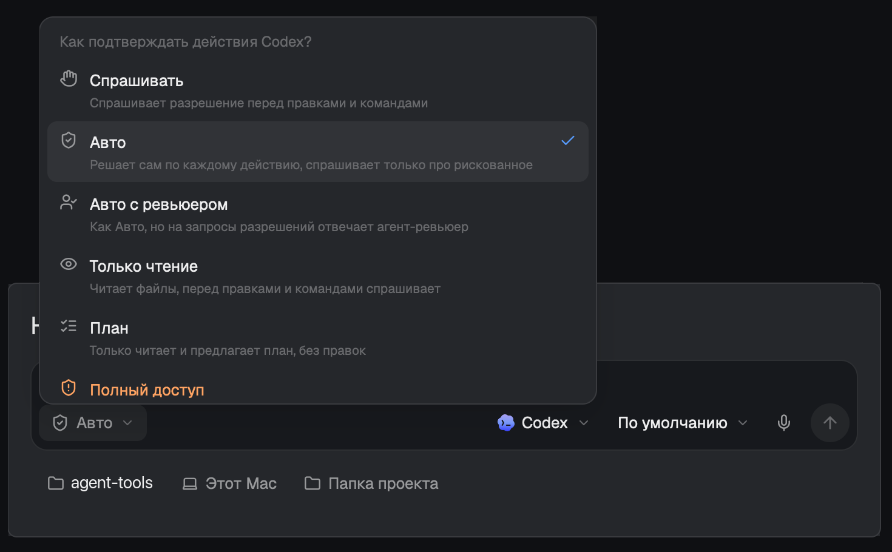
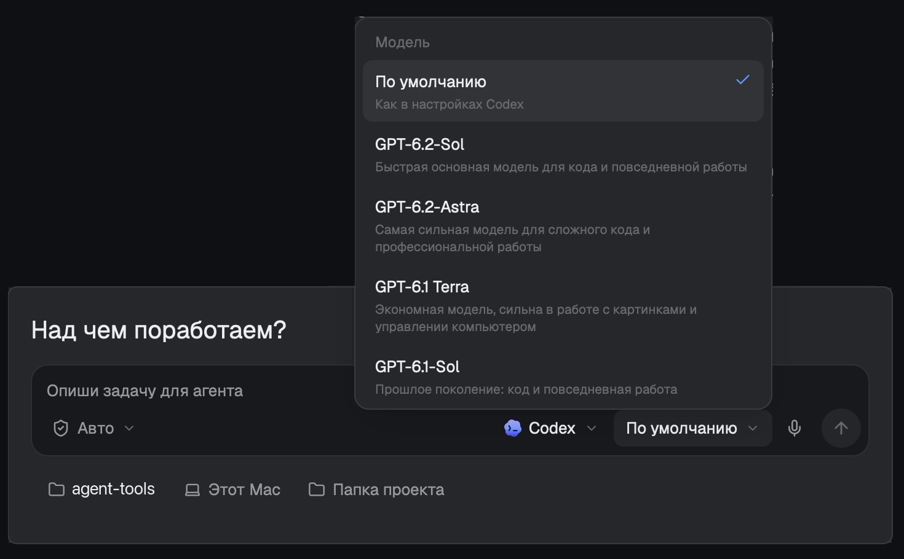
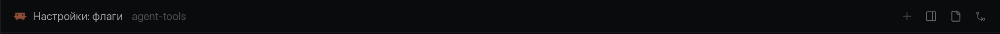
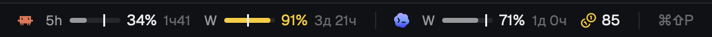
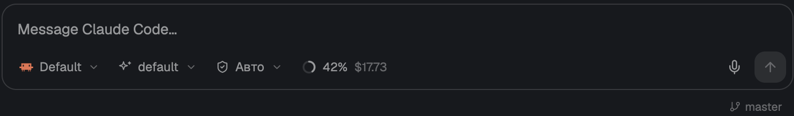

# Herdr Mods

Моды для [Herdr](https://herdr.dev): одно окно для сессий Claude Code и Codex, локальных и на серверах.
Вид и состояния сессий как в Yggdrasil: значки вместо подписей, подсказка при наведении «что это. Клик — что будет».



*One Herdr window for every Claude Code and Codex session, local and remote: a project tree with live agent status,
a Codex-style new-session dialog, a summary panel with context and limits. UI in Russian. Build brief: [RECIPE.md](RECIPE.md).*

| Мод | Где | Что делает |
|---|---|---|
| `ygg-sidebar` | левая панель | Проекты и сессии всех машин: группы, закрепление, объединение проектов с разных машин под одним именем, проекты не пропадают, когда закрыта последняя сессия. Сессии, начатые вне Herdr (приложения Claude и Codex, Codex на сервере), видны в своём проекте и открываются здесь чатом; занятая приложением Claude открывается копией. Правый клик по сессии: переименовать, закрепить, форк, перенести в проект, скопировать команду продолжения или папку, архив. Правый клик по проекту: объединить, разъединить, архив сессий проекта |
| `ygg-new` | окно «Новая сессия» | Агент, модель, режим, машина и папка в одной строке, первый ход отправляется сразу |
| `ygg-settings` | окно настроек | Проекты левой панели без правки JSON |
| `ygg-panel` | правая панель «Сводка» | Среда (машина, папка, ветка), контекст с разбивкой как в Claude, лимиты Claude и Codex, мои PR (GitHub, Bitbucket), хуки Codex, коннекторы. Разделы сворачиваются, перетаскиваются и закрепляются: закреплённые видны поверх сессии, когда панель скрыта |
| `ygg-status` | нижняя строка | Лимиты Claude и Codex всегда на виду: полоска, процент, время до сброса; жёлтая только при перерасходе |
| `ygg-tabs` | верхняя полоса | Заголовок текущей сессии вместо ряда вкладок, кнопки панелей значками |
| `overrides/chat` | чат | Codex на сервере открывается чатом (нужен хост из форка [herdr-chat](https://github.com/Dmitiry1921/herdr-chat/tree/remote-codex-daemon), ветка `remote-codex-daemon`: путь к его `bin/herdr-chat-host` в `mods/chat/config.json` → `host`); чат Codex открывается, даже если Codex перенёс файл сессии; микрофон в поле ввода, текст набирается по ходу речи (нужны `ffmpeg`, `whisper-server` из whisper-cpp, мод `ygg-new` и модель `~/.cache/whisper-cpp/ggml-large-v3-turbo.bin`); свои сообщения в заметном пузыре |

## Как выглядит

Снимки настоящего окна, данные на них выдуманные.

<table>
<tr>
<td width="34%" valign="top"><b>ygg-sidebar</b><br>Проекты по группам, сессии деревом, состояние агента точкой справа: синяя работает, жёлтая ждёт тебя, зелёная закончила. Луна: сессия спит, булавка: закреплена.<br><br></td>
<td width="33%" valign="top"><b>ygg-panel</b><br>Правая панель «Сводка»: среда, контекст с разбивкой как в Claude, лимиты Claude и Codex, мои PR, хуки Codex, коннекторы. Разделы сворачиваются, перетаскиваются и закрепляются.<br><br></td>
<td width="33%" valign="top"><b>ygg-settings</b><br>Настройки левой панели: группы, иконка, цвет и имя проекта, сколько сессий видно. Одинаковое имя у двух проектов собирает их в один.<br><br></td>
</tr>
</table>

### ygg-new: новая сессия

Режим, агент, модель, машина и папка в одной строке, первый ход уходит сразу.



Режимы Claude и Codex в одном виде, со значками и пояснениями. Видны только режимы выбранного агента, «Полный доступ» оранжевый. Модели с пояснениями по-русски.

 

### ygg-tabs и ygg-status

Сверху заголовок текущей сессии и кнопки панелей значками. Снизу лимиты Claude и Codex: полоска, процент, время до сброса.




### overrides/chat: поле ввода чата

Режим со значком из того же общего списка, микрофон с текстом по ходу речи.



`overrides/` это правки встроенных модов Herdr (Apache-2.0, см. `LICENSE`).

## Поставить

Нужны Herdr, Node.js 22+ (для служебных скриптов модов) и, для сессий Codex, `codex` в `PATH`.

Проще всего попросить агента в Herdr: «Добавь раскладку github.com/Dmitiry1921/herdr-mods». Он прочитает
[RECIPE.md](RECIPE.md) и поставит раскладку рядом с твоей, не трогая её. Или руками:

```sh
git clone https://github.com/Dmitiry1921/herdr-mods.git
cd herdr-mods && ./install.sh
herdr-app do layout.switch '{"name":"ygg"}'
```

Свои моды ставятся ссылками на клон: `git pull` обновляет их сразу. Правки встроенных модов копируются поверх,
оригинал остаётся рядом как `.orig`. Папка Herdr по умолчанию `~/.config/herdr-app`, другая задаётся `HERDR_APP_HOME`.

## Убрать

Удалить ссылки `ygg-*` из `~/.config/herdr-app/mods`, вернуть `.orig` на место и переключить раскладку на `main`.

## Настройки

Окно «Настройки панели» (правый клик по проекту, последний пункт): проекты по группам, у каждого иконка, цвет,
имя, группа и сколько сессий видно. Одинаковое имя у двух проектов собирает их в один (Mac и сервер).
Группу проекта можно сменить и прямо из меню проекта, пункт «Группа». Всё хранится в
`~/.config/herdr-app/data/ygg-sidebar/projects.json`.
