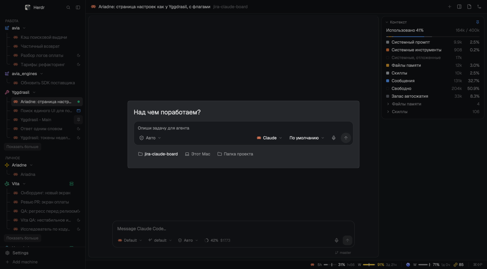

# Ygg

One window for every Claude Code and Codex session, on this Mac and on remote machines. Projects on the left
grouped into Work and Personal, each with its sessions as a tree. The session's chat sits in the middle, and a
right panel shows its context, limits and PRs. Sessions look the same everywhere, with the same colors and the
same icon hints: blue means working, yellow means waiting for you, green means done. The UI is in Russian.

## What you see

Left to right, on the `canvas` background, with 1px `border` dividers and no title bar (traffic lights at 12,16):

- **Sidebar, 268px** (`chrome` background, not resizable):
  - `workspace-chrome` brand row, 46px;
  - `ygg-sidebar` project tree;
  - `workspace-chrome` footer, 69px.
- **Work column:**
  - `ygg-tabs` strip, 42px, with the active session's title and the panel buttons as icons;
  - body row with 8px padding and an 8px gap:
    - the active tab's panes, each a card with radius 10, a 1px `border` frame (the same color when focused), a pane header revealed on hover, and `lone: true`;
    - a `pins` column, 320px, hidden by default;
    - the `panel` stack, 368px, hidden by default: `ygg-panel` summary, `files`, `changes`;
  - `ygg-status` bar, 28px.

### ygg-sidebar

Groups («РАБОТА», «ЛИЧНОЕ») hold projects, and each project holds its sessions as a tree.

- **Project row:** a Lucide icon in the project's color, its name and a chevron.
- **Session row:** the agent logo, the title cut with an ellipsis, and on the right a status dot or a state icon: a moon for parked, a pin for pinned, an app window for a session open in the Claude app.
- **Order:** active sessions first, then outside sessions active in the last 24h, then parked ones, then older outside ones.
- «Показать больше» opens past the per-project limit.
- **Outside sessions** were started outside Herdr: Codex threads (Mac and servers) and Claude desktop sessions. They are shown dimmed, with a machine mark.

### ygg-new

The «Над чем поработаем?» dialog, 720×210:

- a prompt field;
- a mode picker: Ask, Edits, Auto, Review, Read-only, Plan and Full, each with a Lucide icon and a one-line hint. Full is orange, `#fea362`;
- the agent (Claude or Codex) and the model, as popover lists;
- a mic button and a send arrow;
- below them, the project, the machine, and Project folder ↔ New worktree (folder icon, or a blue branch icon).

### ygg-panel

Collapsible, draggable and pinnable sections:

- the environment: machine, folder, branch;
- the context breakdown, as in Claude's `/context`;
- Claude limits (orange) and Codex limits (blue);
- my PRs on GitHub and Bitbucket;
- Codex hooks;
- connectors with brand icons.

### ygg-status

The Claude and Codex limits as thin neutral bars, each with the agent logo, a percentage and the time to reset («45м», «2ч30», «4д 23ч»). A bar turns yellow only on overuse.

## How it behaves

### Agent statuses

The status colors come from `ygg-sidebar/main.js`:

| Status | Color | Hint on hover | Shown in |
|---|---|---|---|
| working | `#579dff` | «Агент работает» | sidebar dot, tabs strip |
| blocked | `#f5cd47` | «Агент ждёт тебя» | sidebar dot, tabs strip |
| done | `#2abb7f` | «Агент закончил, ты ещё не смотрел» | sidebar dot, tabs strip |
| idle | `#9fadbc` | «Сессия открыта, агент простаивает» | sidebar dot, tabs strip |

When a project is folded, it shows its most urgent status, in the order blocked > done > working > idle.

### Clicks

- **Session row:** switches to its tab.
- **Parked session:** reopens as a herdr-chat chat on that session.
- **Outside session:** opens here as a chat.
- **Session busy in the Claude app:** forked first, so two processes never write one file.
- **Project row:** folds or unfolds it.

### Right-click menus

- **Session:**
  - rename
  - pin
  - fork
  - move to a project
  - copy the resume command
  - copy the folder path
  - archive
- **Project:**
  - group
  - merge or unmerge with the same name on another machine
  - archived sessions (restore)
  - «Настройки панели» (`ygg-settings` dialog, 640×560)

### Hints

Icon-only buttons carry a short hover hint: «what it is. Клик — what happens».

## Built from

**Layout:** `layouts/ygg.json`, a clone of the shipped `main` (0.1.16) with the regions above.

**Mods**, each under `mods/`:

| Mod | What it is | Programs it runs |
|---|---|---|
| `ygg-sidebar` | sidebar tree | `external.mjs` scans the Codex `~/.codex/state_*.sqlite` (`node:sqlite`) and Claude desktop `claude-code-sessions/*.json`, every 30s; servers are scanned through `hc exec`. Shared state goes in `ygg.ext`. Config: `data/ygg-sidebar/projects.json` |
| `ygg-new` | new-session dialog | `start.mjs` sends the first turn. `dictate.mjs` records with `ffmpeg` and transcribes with `whisper-server`, using the model `~/.cache/whisper-cpp/ggml-large-v3-turbo.bin` |
| `ygg-panel` | right-panel summary | `collect.mjs` every 5s. Claude limits come from a 15-minute `claude -p ok --model haiku` probe. PRs come from `gh` and from Bitbucket Server REST with `BITBUCKET_TOKEN` (env, `~/.config/ott/.env` or Keychain) |
| `ygg-tabs` | top strip | none |
| `ygg-status` | bottom bar | none |
| `ygg-settings` | sidebar settings dialog | none |

**Patches** to the shipped `chat` mod: `overrides/chat/`, copied over by `install.sh`, which keeps the original as `.orig`. They add:

- the common mode look (`modes.js`);
- live dictation in the composer;
- Codex on a server as a chat, which needs the `remote-codex-daemon` branch of the [herdr-chat fork](https://github.com/Dmitiry1921/herdr-chat/tree/remote-codex-daemon);
- your own messages in a visible bubble.

**Art:** Lucide 0.460.0 icons, and Simple Icons and lobehub logos for brands.

## Watch out

- **Network and programs.** The mods reach the network (GitHub, Bitbucket), run programs (`hc`, `gh`, `claude`, `codex`, `ffmpeg`, `whisper-server`, `node` 22.5 or newer) and read files outside their folder: `~/.codex`, `~/.claude`, and the Claude desktop data.
- **Mac-only paths.** Claude desktop sessions are read from `~/Library/Application Support/Claude`, so that source only exists on macOS.
- **Chat patches.** The `overrides/chat` patches replace shipped files. A Herdr update can rewrite them, so run `install.sh` again after one.
- **Busy sessions.** A Claude session is busy when `ps` shows a process with `--resume=<id>`. Opening it directly would make two writers on one file, so it is forked instead.
- **Restarts.** Mods reload with `touch -h ~/.config/herdr-app/mods/<mod>`. Do not restart the herdr-core holder: that kills every terminal.

## Done when

- `herdr-app check mods/<each>` passes.
- `layout.switch {"name":"ygg"}` shows the sidebar, the tabs strip and the status bar.
- A running Claude session shows a blue dot in the sidebar.
- `mod.open {"name":"ygg-new"}` opens «Над чем поработаем?», and its mode list shows icons with hints.
- A Codex thread started in the Codex app in the last 7 days appears dimmed under its project, and a click opens it as a chat.
